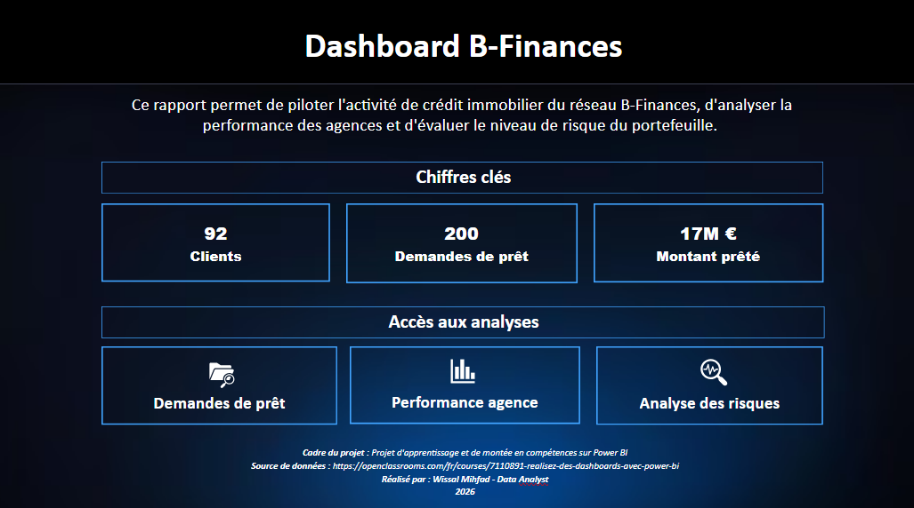
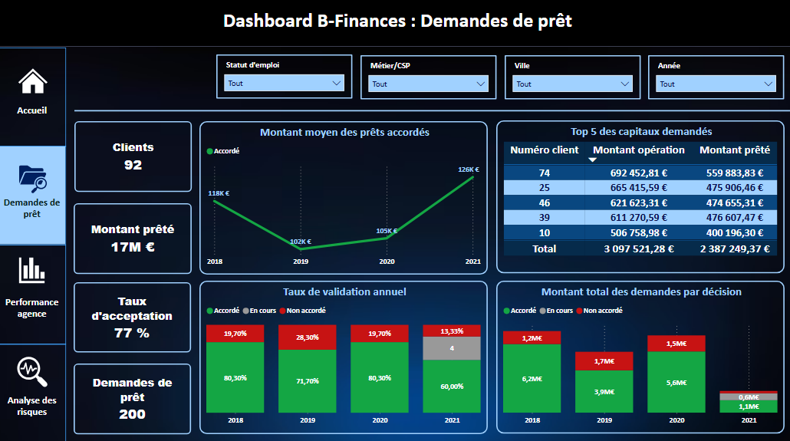
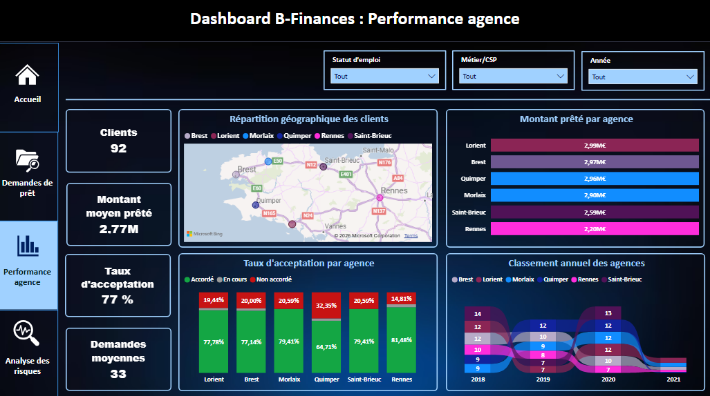
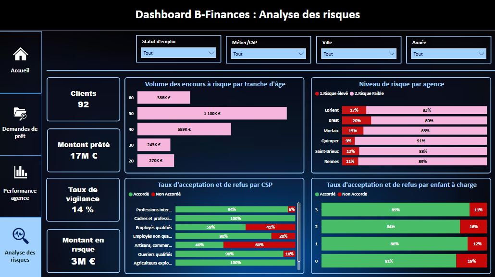

# Projet 1 : B-Finances, dashboard d'analyse de crédits immobiliers

Dashboard Power BI de pilotage de l'activité de prêts immobiliers d'une banque régionale bretonne : suivi des demandes, performance des agences et analyse des risques.

> 📚 **Projet d'apprentissage** basé sur le cas d'étude « Crédit Breton » du cours OpenClassrooms [« Réalisez des dashboards avec Power BI »](https://openclassrooms.com/fr/courses/7110891-realisez-des-dashboards-avec-power-bi). Le jeu de données et le cas d'usage proviennent de ce cours.

## 🎯 Contexte et objectifs
La direction disposait de rapports macroéconomiques figés d'un côté et de registres de dossiers de l'autre, sans lien entre les deux. Le dashboard répond à trois objectifs :
1. **Transparence** : visualiser les volumes et descendre jusqu'au profil de chaque emprunteur (drill-through).
2. **Performance commerciale** : comparer les 6 agences (Brest, Lorient, Morlaix, Quimper, Rennes, Saint-Brieuc).
3. **Maîtrise des risques** : surveiller la politique d'octroi par âge, profession et situation familiale.

## 📊 Chiffres clés
- 👥 92 clients · 📄 200 demandes de prêt · 💶 17 M€ prêtés (2018 à 2021)
- ✅ Taux d'acceptation global : 77 %
- 🚨 Taux de vigilance : 14 % · Montant en risque : 3 M€

## 🖇️ Ce que j'ai réalisé
- **Power Query** : nettoyage des données, fusion de la table Apport dans la table de faits (jointure externe gauche).
- **Modèle en étoile** : 1 table de faits (Demandes de prêt), 3 dimensions (Agences, Clients, Calendrier) et une table dédiée aux mesures.
- **7 mesures DAX** : Nombre de demandes, Montant prêté, Taux d'acceptation, Montant en risque, Taux de vigilance, Montant moyen agence, Demandes moyennes agence (avec CALCULATE, DIVIDE, AVERAGEX et ALL).
- **Colonnes calculées** : score emprunteur (règles : âge, régularité des revenus, taux d'endettement > 35 %), niveau de risque, tranches d'âge.
- **Rapport de 5 pages** : 3 pages d'analyse, navigation par boutons, filtres dynamiques et 2 pages de drill-through.

## 📌 Aperçu du dashboard

### Accueil

### Demandes de prêt

### Performance des agences

### Analyse des risques

## 💡 Principaux constats
- **Sélectivité inégale selon les agences** : Quimper accorde 64,7 % des dossiers contre 81,5 % à Rennes.
- **Risque par agence** : Brest affiche 20 % de dossiers à risque élevé, contre 9 % à Quimper.
- **Risque par âge** : la tranche des 50 ans concentre le plus d'encours à risque (1,1 M€).
- **Risque par profession** : 60 % de refus pour les artisans et commerçants, contre 100 % d'accords pour les cadres.
- **Segment intérim** : taux de vigilance de 67 %, mais sur un échantillon très réduit (2 clients).

## ✅ Recommandations formulées
1. Renforcer les exigences de garantie et d'assurance sur les tranches d'âge à fort risque.
2. Harmoniser les règles d'octroi entre agences.
3. Revoir la grille de scoring pour les indépendants et l'intérim (apport personnel majoré).

## 📘 Documentation complète
Le rapport détaillé (modèle, dictionnaire des mesures DAX, analyse page par page, scénarios d'utilisation, perspectives) est disponible ici :
👉 [Rapport d'activité (PDF)](BFinancesDoc.pdf)

## 📁 Fichiers
- [Rapport Power BI (.pbix)](RapportBFinances.pbix)
- [Données (Excel)](DataCB.xlsx)

## 🧰 Outils
Power BI Desktop · DAX · Power Query · Excel
