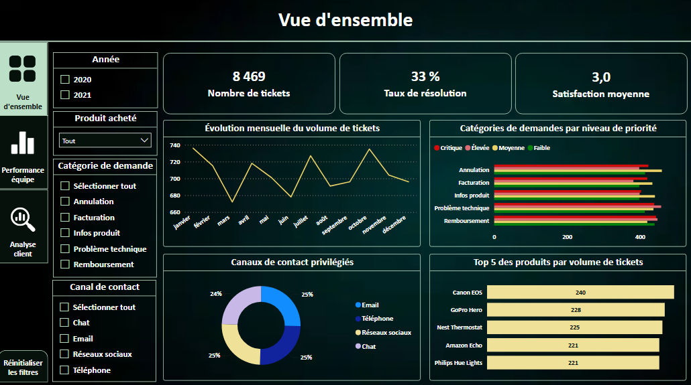
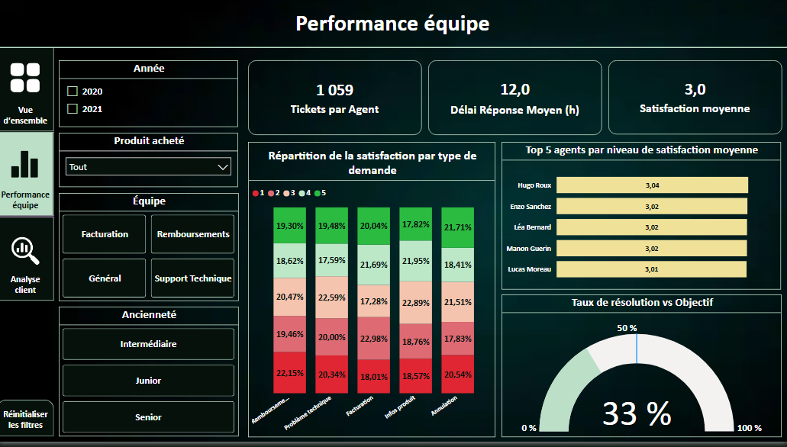
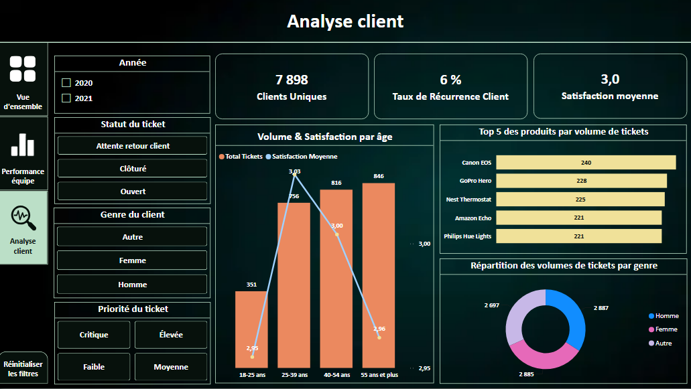

# Projet 2 : GlobalTech, dashboard de performance du support client

Dashboard Power BI de pilotage du service support : volume et priorité des tickets, performance des équipes et analyse du comportement des clients (2020 à 2021).

> 📚 **Projet d'apprentissage** réalisé pour consolider mes compétences Power BI (Power Query, modélisation, DAX, design de rapports). Les données proviennent du jeu de données public [Customer Support Ticket Dataset](https://kaggle.com/datasets/suraj520/customer-support-ticket-dataset) (Kaggle). Le cas d'usage GlobalTech, le modèle de données, les mesures DAX, les pages du rapport et l'analyse sont mon travail.

## 🎯 Contexte et objectifs
La direction manquait de visibilité sur l'efficacité du support : les données de tickets restaient cloisonnées ou exploitées de façon statique. Le dashboard répond à trois besoins :
1. **Pilotage global** : suivre les volumes et anticiper les pics d'activité.
2. **Performance opérationnelle** : mesurer les délais, le taux de résolution et la satisfaction par équipe et par niveau d'ancienneté.
3. **Comportement client** : analyser la satisfaction et la récurrence selon l'âge, le genre, le produit et la priorité.

## 🔍 Problématique Métier

Dans un marché concurrentiel, le service support de **Global Tech** génère quotidiennement un volume massif de données transactionnelles issues des tickets d'assistance[cite: 30]. Jusqu'à présent, ces données restaient cloisonnées ou exploitées de manière statique, empêchant une lecture globale et fluide des performances opérationnelles et de l'expérience client[cite: 30].

Face à cet enjeu de gouvernance et de pilotage, la problématique centrale à résoudre était la suivante : 
> **Comment centraliser et analyser dynamiquement le cycle de vie des tickets d'assistance pour concilier optimisation de la charge opérationnelle des agents, respect des objectifs de résolution et amélioration continue de la satisfaction client ?**

Pour répondre à ce défi, la solution décisionnelle a été conçue autour de 3 axes stratégiques :
1. **Pilotage macro-économique :** Obtenir une vision consolidée des volumes de demandes pour anticiper la saisonnalité et identifier les produits les plus générateurs d'incidents[cite: 30].
2. **Optimisation opérationnelle :** Évaluer l'efficacité des équipes (délais de réponse, taux de résolution face à l'objectif de 50%, et répartition par ancienneté) afin d'ajuster la charge de travail et cibler les besoins d'accompagnement[cite: 30, 41].
3. **Analyse de l'expérience et du comportement client :** Mesurer la satisfaction (CSAT), la récurrence des pannes et les frictions selon les segments démographiques (âge, genre) et les niveaux de criticité des requêtes[cite: 30, 44].

## 📊 Chiffres clés
- 🎫 8 469 tickets · 👤 7 898 clients uniques (2020 à 2021)
- ✅ Taux de résolution : 33 % (objectif fixé à 50 %)
- ⭐ Satisfaction moyenne : 3,0 / 5
- ⏱️ Délai moyen de première réponse : 12 h
- 🔁 Taux de récurrence client : 6 %

## 🖇️ Ce que j'ai réalisé
- **Power Query** : connexion et préparation des tables sources (tickets, clients, agents).
- **Modèle en étoile** : 1 table de faits (Tickets), 4 tables de dimensions (Clients, Agents, Calendrier, RefPriorités) et une table dédiée aux mesures.
- **9 mesures DAX** : Total Tickets, Tickets Résolus, Taux de Résolution, Tickets par Agent, Délai Réponse Moyen, Satisfaction Moyenne, Clients Uniques, Taux de Récurrence Client et Objectif Résolution (avec CALCULATE, DIVIDE, AVERAGEX, FILTER et des variables).
- **Colonnes calculées** : tranche d'âge des clients et table de référence pour trier logiquement les priorités.
- **Rapport de 3 pages** avec filtres, boutons de réinitialisation et filtrage croisé.

## 📌 Aperçu du dashboard

### Page 1 : Vue d'ensemble

### Page 2 : Performance équipe

### Page 3 : Analyse client

## 💡 Principaux constats
- **Résolution sous l'objectif** : 33 % de tickets clôturés contre 50 % visés, ce qui indique un point de blocage dans le traitement.
- **Produits les plus sollicités** : le Canon EOS (240 tickets) et la GoPro Hero (228) génèrent le plus de demandes.
- **Canaux équilibrés** : Email, Téléphone, Chat et Réseaux sociaux représentent chacun environ 25 % des contacts.
- **Satisfaction très homogène** : les notes des agents s'étalent entre 3,01 et 3,04, ce qui suggère que les leviers sont surtout dans les processus plutôt que chez les individus.
- **Effet de l'âge** : le volume de tickets passe de 351 (18-25 ans) à 846 (55 ans et plus), avec une satisfaction légèrement plus basse chez les plus de 55 ans (2,96).

## ✅ Recommandations formulées
1. Auditer le processus de clôture des tickets pour réduire l'écart avec l'objectif de 50 %.
2. Revoir les conditions de remboursement, source d'insatisfaction sur certains produits.
3. Créer un protocole d'assistance renforcé pour les clients seniors (guides pas-à-pas, documentation simplifiée).

## 📘 Documentation complète
Le rapport détaillé (modèle, dictionnaire des mesures DAX, analyse page par page, scénarios d'interaction) est disponible ici :
👉 [Rapport d'analyse (PDF)](GlobalTechDoc.pdf)

## 📁 Fichiers
- [Rapport Power BI (.pbix)](RapportGlobalTech.pbix)
- [Tickets de support (CSV)](customer_support_tickets.csv)
- [Clients (CSV)](DimClients.csv)
- [Agents (CSV)](DimAgents.csv)

## 🧰 Outils
Power BI Desktop · DAX · Power Query
