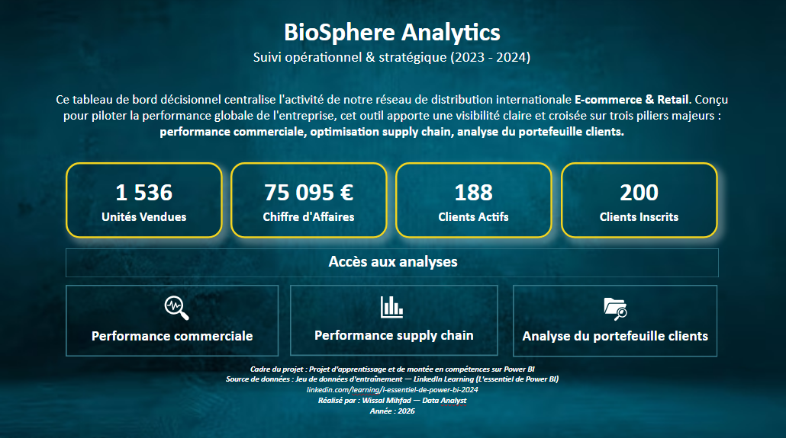
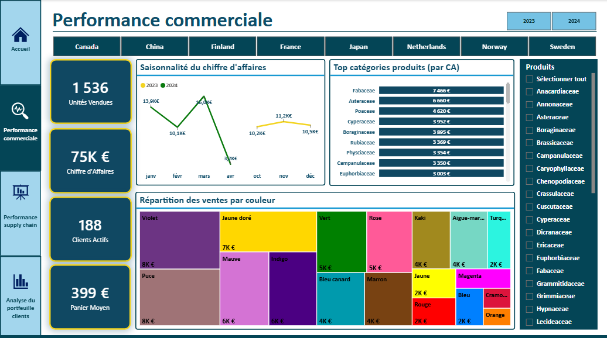
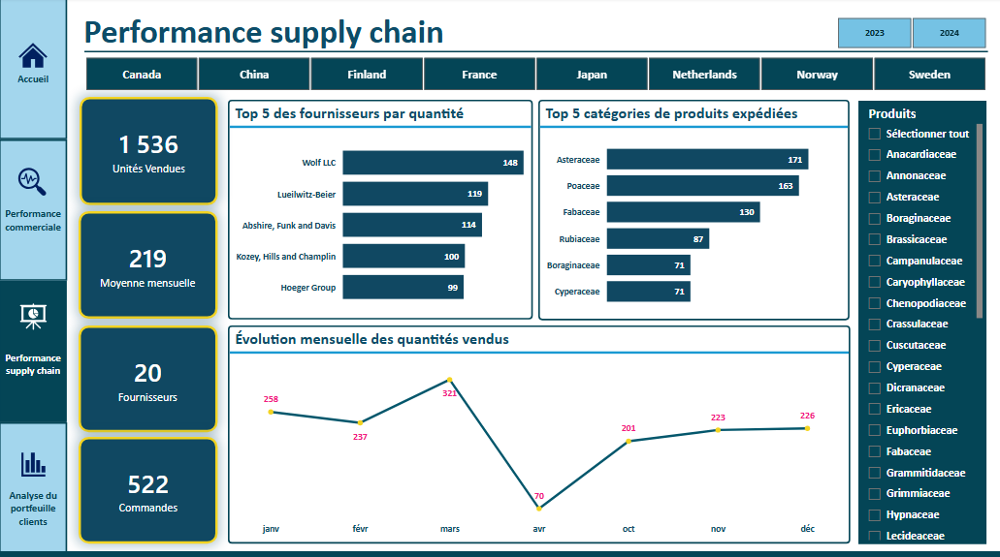
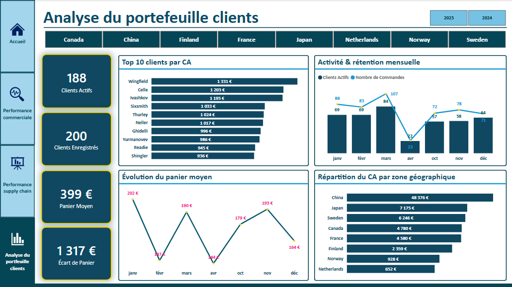

# Projet 3 : BioSphere Analytics, dashboard de pilotage commercial et logistique

Dashboard Power BI de suivi d'une activité internationale de distribution de produits botaniques (E-commerce et Retail) : performance commerciale, supply chain et portefeuille clients (2023 à 2024).

> 📚 **Projet d'apprentissage** réalisé pour consolider mes compétences Power BI. Le jeu de données d'entraînement provient du cours LinkedIn Learning [« L'essentiel de Power BI »](https://www.linkedin.com/learning/l-essentiel-de-power-bi-2024).

## 🎯 Contexte et objectifs
La direction souhaitait sortir des rapports statiques Excel pour disposer d'un pilotage centralisé et interactif. Le dashboard s'articule autour de trois piliers :
1. **Performance commerciale** : suivre le chiffre d'affaires, la saisonnalité et la contribution des familles de produits.
2. **Performance supply chain** : mesurer les volumes expédiés, le nombre de commandes et la répartition entre fournisseurs.
3. **Portefeuille clients** : suivre l'activité, le panier moyen et la répartition géographique du chiffre d'affaires.

## 🔍 Problématique métier
Dans un marché international de distribution botanique (E-commerce B2C et Retail B2B), la direction de **BioSphere Analytics** faisait face à une limite critique : l'exploitation de rapports statiques (Excel) qui cloisonnait les données et empêchait un pilotage décisionnel fluide et en temps réel.

Face à cet enjeu de transformation data-driven, la problématique centrale à résoudre était la suivante :
> **Comment centraliser, unifier et analyser dynamiquement l'écosystème de données pour piloter la croissance commerciale, optimiser les flux logistiques internationaux et maximiser la valeur du portefeuille clients ?**

Pour répondre à ce défi, la solution décisionnelle a été conçue autour de 3 axes stratégiques :
1. **Pilotage de la performance commerciale :** Assurer le suivi dynamique du chiffre d'affaires, analyser les cycles de saisonnalité (pics d'activité et périodes creuses) et identifier la contribution des familles botaniques leaders dans la génération de valeur.
2. **Optimisation de la Supply Chain :** Piloter les volumes d'expédition (unités et commandes), lisser la charge de travail mensuelle et évaluer la dépendance vis-à-vis des partenaires d'approvisionnement par marché de destination.
3. **Analyse et segmentation du portefeuille clients :** Mesurer le niveau d'engagement de la base (clients actifs vs inscrits), suivre l'évolution des paniers moyens et identifier la dispersion des achats ainsi que la contribution des marchés géographiques clés (comme la Chine ou la Suède).

## 📊 Chiffres clés
- 📦 1 536 unités vendues · 🧾 522 commandes · 🏭 20 fournisseurs
- 💶 75 095 € de chiffre d'affaires
- 👤 188 clients actifs sur 200 clients enregistrés
- 🛒 Panier moyen par client : 399 €

## 🖇️ Ce que j'ai réalisé
- **Power Query** : normalisation des types, nettoyage de la casse et des espaces, masquage des clés techniques dans la vue rapport.
- **Modèle en étoile** : 1 table de faits (ventes 2023-2024), 4 dimensions (Clients, Produits, Fournisseurs, Calendrier) et une table dédiée aux mesures.
- **Gestion des dates** : une table Calendrier avec deux relations vers la table de faits, l'une active (date de commande), l'autre inactive (date de livraison).
- **10 mesures DAX** : CA, Quantité vendue, Nombre de commandes, Clients actifs, Clients enregistrés, Moyenne mensuelle, Panier moyen par client, Panier min, Panier max et Écart de panier (avec SUMX, AVERAGEX, MAXX, MINX, DISTINCTCOUNT et KEEPFILTERS).
- **Rapport de 4 pages** : accueil de navigation, 3 pages d'analyse, filtres par pays et par année, interactions croisées paramétrées.

## 📌 Aperçu du dashboard

### Page 1 : Accueil

### Page 2 : Performance commerciale

### Page 3 : Performance supply chain

### Page 4 : Analyse du portefeuille clients

## 💡 Principaux constats
- **Concentration géographique** : la Chine génère 48 376 € sur 75 095 € de chiffre d'affaires, soit près des deux tiers.
- **Familles les plus rentables** : les Fabaceae (7 466 €) et les Asteraceae (6 660 €) arrivent en tête du chiffre d'affaires.
- **Fournisseurs répartis** : le premier fournisseur représente environ 10 % des unités (148 sur 1 536), sans dépendance marquée.
- **Clientèle active** : 188 clients actifs sur 200 inscrits, soit un faible nombre de comptes dormants.
- **Paniers très hétérogènes** : un écart de 1 317 € entre le plus petit et le plus gros panier, signe d'une coexistence de petites commandes (E-commerce) et de gros volumes (Retail).

## 🔭 Perspectives d'évolution
1. Intégrer les coûts d'achat et de transport pour analyser la marge brute par produit et par pays.
2. Ajouter des alertes visuelles (rouge/vert) sur les volumes fournisseurs.
3. Ajouter une prévision de la saisonnalité à partir de l'historique.

## 📘 Documentation complète
Le rapport détaillé (modèle, formules DAX, analyse page par page, choix de design et d'interactions) est disponible ici :
👉 [Rapport de projet (PDF)](BioSphereAnalyticsDoc.pdf)

## 📁 Fichiers
- [Rapport Power BI (.pbix)](RapportBioSphere.pbix)
- [Données de ventes (Excel)](04_01_ventes.xlsx)

## 🧰 Outils
Power BI Desktop · DAX · Power Query · Excel
