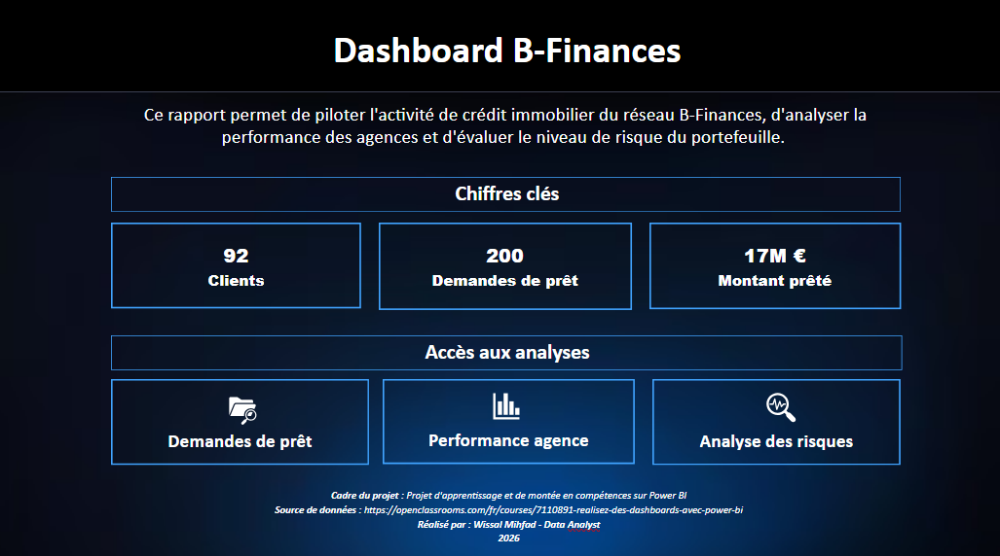

# 📊 Portfolio Power BI | Data Analyst

Data Analyst & Business Analyst certifiée Microsoft Power BI (PL-300). Ce dépôt rassemble trois projets d'apprentissage : de la préparation des données (Power Query) à la modélisation, aux mesures DAX et à la restitution en tableaux de bord interactifs.

📩 wissalmihfad10@gmail.com · 💼 [LinkedIn](https://linkedin.com/in/wissal-m-b23928261)

Chaque projet contient un README détaillé, des captures du dashboard, le fichier .pbix et un rapport PDF.

---

## Projet 1 : B-Finances (crédit immobilier)
**Dashboard décisionnel et analyse de la politique d'octroi**

### 🎯 Objectif
Piloter l'activité de crédit immobilier d'un réseau bancaire régional : suivre les demandes de prêt, comparer les agences et surveiller le risque du portefeuille.

### 🛠️ Compétences et réalisations
* **Power Query** : nettoyage, structuration et fusion des tables sources.
* **Modélisation** : modèle en étoile (table de faits, dimensions Agences, Clients et Calendrier).
* **DAX** : taux d'acceptation, montant prêté, montant en risque, taux de vigilance, scoring emprunteur.
* **Restitution** : rapport de 5 pages avec navigation, filtres dynamiques et drill-through.

📚 *Projet d'apprentissage basé sur le cas d'étude « Crédit Breton » du cours OpenClassrooms [« Réalisez des dashboards avec Power BI »](https://openclassrooms.com/fr/courses/7110891-realisez-des-dashboards-avec-power-bi).*

👉 [Voir le projet](Projet-1-B-Finances) · 📘 [Rapport PDF](Projet-1-B-Finances/B-Finances%20Doc.pdf) · 📈 [Fichier .pbix](Projet-1-B-Finances/PBI%20B-Finances.pbix)

---

## Projet 2 : GlobalTech, performance du support client
**Performance du support et expérience client (2020 à 2021)**

### 🎯 Objectif
Centraliser et analyser les tickets d'un service support pour transformer des données cloisonnées en leviers d'action :
* 📈 **Pilotage global** : vision consolidée des volumes et anticipation des pics d'activité.
* 👥 **Performance opérationnelle** : délais de réponse, taux de résolution et satisfaction par équipe.
* 🧑‍💼 **Comportement client** : satisfaction (CSAT) et récurrence selon les produits, les canaux et les profils.

### 🛠️ Compétences et réalisations
* **Power Query** : connexion, nettoyage et transformation du jeu de données.
* **Modélisation** : modèle en étoile (Tickets, Clients, Agents, Calendrier, RefPriorités).
* **DAX** : taux de résolution, satisfaction moyenne, délai de réponse moyen, taux de récurrence client.
* **Restitution** : rapport de 3 pages avec filtres et filtrage croisé.

📚 *Données : [Customer Support Ticket Dataset](https://kaggle.com/datasets/suraj520/customer-support-ticket-dataset) (Kaggle).*

👉 [Voir le projet](Projet-2-GlobalTech) · 📘 [Rapport PDF](Projet-2-GlobalTech/GlobalTech%20Doc.pdf) · 📈 [Fichier .pbix](Projet-2-GlobalTech/PBI%20GlobalTech.pbix)

---

## Projet 3 : BioSphere Analytics, distribution botanique
**Suivi opérationnel et stratégique (E-commerce et Retail)**

### 🎯 Objectif
S'affranchir des rapports statiques Excel avec une vision à 360° articulée autour de trois piliers :
* **Performance commerciale** : suivi du chiffre d'affaires (75 K€), saisonnalité et produits leaders.
* **Supply chain** : suivi des expéditions et des volumes (1 536 unités vendues).
* **Portefeuille clients** : engagement de la base (200 clients enregistrés, 188 actifs).

### 🛠️ Compétences et réalisations
* **Power Query** : centralisation, nettoyage et structuration des données.
* **Modélisation** : modèle en étoile avec table Calendrier (relations active et inactive).
* **DAX** : chiffre d'affaires, quantités, clients actifs, panier moyen et écart de panier.
* **UX/UI** : page d'accueil de navigation et interactions croisées paramétrées.

📚 *Données d'exercice du cours LinkedIn Learning [« L'essentiel de Power BI »](https://www.linkedin.com/learning/l-essentiel-de-power-bi-2024).*

👉 [Voir le projet](Projet-3-BioSphere) · 📘 [Rapport PDF](Projet-3-BioSphere/BioSphereAnalyticsDoc.pdf) · 📈 [Fichier .pbix](Projet-3-BioSphere/RapportBioSphere.pbix)

---

👩‍💻 **Réalisé par :** Wissal Mihfad, *Data Analyst*

# 📊 Portfolio Power BI — Data Analyst

Bienvenue sur mon portfolio Power BI. Ce dépôt rassemble des projets d'analyse de données conçus pour répondre à des problématiques métier concrètes.

---

## Projet 1 : Crédit Immobilier B-Finances
**Dashboard décisionnel et analyse de la politique d'octroi**

### Objectif métier
Analyse de l'activité de crédit immobilier pour le réseau B-Finances afin de piloter l'octroi de prêts, évaluer le risque et optimiser la prise de décision financière.

### Compétences techniques & Realisations
* **Préparation des données (Power Query) :** Nettoyage, structuration et transformation du jeu de données bancaires.
* **Modélisation de données :** Conception d'un modèle relationnel optimisé pour l'analyse financière.
* **Calculs DAX :** Création d'indicateurs clés (taux d'acceptation, encours de crédit, profil de risque des emprunteurs).
* **Restitution visuelle :** Conception d'un tableau de bord décisionnel clair et interactif.

### Fichiers du projet
* Rapport Power BI : `Projet-1-BioSphere/PBI B-Finances.pbix`
* Données brutes : `Projet-1-BioSphere/DataCB.xlsx`
* Documentation complète : `Projet-1-BioSphere/B-Finances Doc.pdf`

---
## Projet 2 : Customer Support Analytics — GlobalTech
**Performance du support & expérience client**

### Objectif métier
Déploiement d'une solution décisionnelle (BI) complète sur Power BI pour centraliser et analyser les flux de tickets du service support. L'objectif est de transformer des données transactionnelles cloisonnées en leviers d'action :
* **Pilotage macro-économique :** Vision consolidée des volumes de demandes et anticipation des pics d'activité.
* **Optimisation opérationnelle :** Évaluation de la performance des agents (délais de réponse, taux de résolution) pour ajuster la charge de travail.
* **Analyse comportementale client :** Mesure de la satisfaction (CSAT) et de la récurrence selon les produits et canaux.

### Compétences techniques & Réalisations
* **Préparation des données (Power Query) :** Connexion, nettoyage et transformation du jeu de données *Customer Support Ticket Dataset* (Kaggle).
* **Modélisation de données :** Structuration d'un modèle relationnel optimisé pour l'analyse décisionnelle.
* **Restitution visuelle :** Création d'un rapport unifié structuré autour de **trois tableaux de bord dédiés**.

### Fichiers du projet
* Rapport Power BI : `Projet-2-GlobalTech/PBI GlobalTech.pbix`
* Données brutes : `Projet-2-GlobalTech/DimAgents.csv` , `Projet-2-GlobalTech/DimClients.csv` , `Projet-2-GlobalTech/customer_support_tickets`
* Documentation cadrage : `Projet-2-GlobalTech/GlobalTech Doc.pdf`

---

## Projet 3 : BioSphere Analytics — Distribution Botanique & E-commerce
**Suivi opérationnel & stratégique (2023 - 2024)**

### Objectif métier
Déploiement d'une solution décisionnelle complète sur Power BI pour un réseau de distribution internationale de produits botaniques (E-commerce & Retail). L'objectif est de s'affranchir des rapports statiques (Excel) et d'apporter une vision à 360° articulée autour de trois piliers majeurs :
* **Performance commerciale :** Suivi dynamique du CA (75k€+), analyse de la saisonnalité des ventes et identification des produits leaders.
* **Optimisation Supply Chain :** Suivi opérationnel des expéditions et des volumes vendus (1 500+ unités).
* **Analyse du portefeuille clients :** Suivi de l'engagement des membres inscrits (200 clients) et ciblage des clients actifs (188 clients).

### Compétences techniques & Réalisations
* **Préparation des données (Power Query) :** Centralisation, nettoyage et structuration des données transactionnelles et clients.
* **Modélisation de données :** Conception d'un modèle optimisé reliant les flux de ventes, produits et clients.
* **UX/UI & Ergonomie :** Création d'un portail de navigation unifié (page d'accueil interactive) permettant un accès fluide aux différents axes d'analyse.
* **Calculs DAX :** Élaboration des indicateurs de santé globale (CA, unités vendues, taux d'activité client).

### Fichiers du projet
* Rapport Power BI : `Projet-3-BioSphere/PBI BioSphere.pbix`
* Données brutes : `Projet-3-BioSphere/04_01_ventes.xlsx`
* Documentation complète : `Projet-3-BioSphere/BioSphere Analytics Doc.pdf`
---

👨‍💻 **Réalisé par :** Wissal Mihfad — *Data Analyst*
