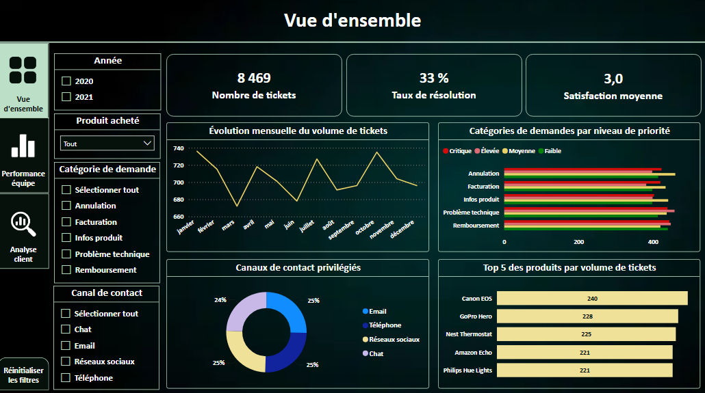
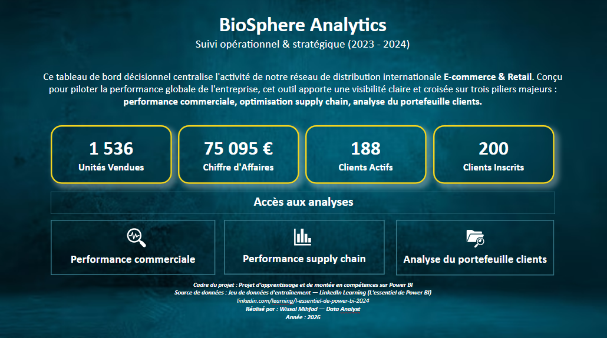

# 📊 Portfolio Power BI | Data Analyst

Data Analyst & Business Analyst certifiée Microsoft Power BI (PL-300). Ce dépôt rassemble trois projets pratiques : de la préparation des données (Power Query) à la modélisation, aux mesures DAX et à la restitution en tableaux de bord interactifs.

Chaque projet contient un README détaillé, des captures du dashboard, les données sources, le fichier .pbix et un rapport PDF.

---

## Projet 1 : B-Finances (crédit immobilier)
**Dashboard décisionnel et analyse de la politique d'octroi**

### 🎯 Objectif
Piloter l'activité de crédit immobilier d'un réseau bancaire régional : suivre les demandes de prêt, comparer les agences et surveiller le risque du portefeuille.

### 🛠️ Compétences et réalisations
* **Power Query** : nettoyage, structuration et fusion des tables sources.
* **Modélisation** : modèle en étoile (table de faits, dimensions Agences, Clients et Calendrier).
* **DAX** : taux d'acceptation, montant prêté, montant en risque, taux de vigilance, scoring emprunteur.
* **Restitution** : rapport de 5 pages avec navigation, filtres dynamiques et drill-through.

📚 *Projet de montée en compétences basé sur le cas d'étude « Crédit Breton » du cours OpenClassrooms [« Réalisez des dashboards avec Power BI »](https://openclassrooms.com/fr/courses/7110891-realisez-des-dashboards-avec-power-bi).*

👉 [Voir le projet](Projet-1-B-Finances) · 📘 [Rapport PDF](Projet-1-B-Finances/BFinancesDoc.pdf) · 📈 [Fichier .pbix](Projet-1-B-Finances/RapportBFinances.pbix)

---

## Projet 2 : GlobalTech, performance du support client
**Performance du support et expérience client (2020 à 2021)**

### 🎯 Objectif
Centraliser et analyser les tickets d'un service support pour transformer des données cloisonnées en leviers d'action :
* **Pilotage global** : vision consolidée des volumes et anticipation des pics d'activité.
* **Performance opérationnelle** : délais de réponse, taux de résolution et satisfaction par équipe.
* **Comportement client** : satisfaction (CSAT) et récurrence selon les produits, les canaux et les profils.

### 🛠️ Compétences et réalisations
* **Power Query** : connexion, nettoyage et transformation du jeu de données.
* **Modélisation** : modèle en étoile (Tickets, Clients, Agents, Calendrier, RefPriorités).
* **DAX** : taux de résolution, satisfaction moyenne, délai de réponse moyen, taux de récurrence client.
* **Restitution** : rapport de 3 pages avec filtres et filtrage croisé.

📚 *Données : [Customer Support Ticket Dataset](https://kaggle.com/datasets/suraj520/customer-support-ticket-dataset) (Kaggle).*

👉 [Voir le projet](Projet-2-GlobalTech) · 📘 [Rapport PDF](Projet-2-GlobalTech/GlobalTechDoc.pdf) · 📈 [Fichier .pbix](Projet-2-GlobalTech/RapportGlobalTech.pbix)

---

## Projet 3 : BioSphere Analytics, distribution botanique
**Suivi opérationnel et stratégique (E-commerce et Retail)**

### 🎯 Objectif
S'affranchir des rapports statiques Excel avec une vision à 360° articulée autour de trois piliers :
* **Performance commerciale** : suivi du chiffre d'affaires (75 K€), saisonnalité et produits leaders.
* **Supply chain** : suivi des expéditions et des volumes (1 536 unités vendues).
* **Portefeuille clients** : engagement de la base (200 clients enregistrés, 188 actifs).

### 🛠️ Compétences et réalisations
* **Power Query** : centralisation, nettoyage et structuration des données.
* **Modélisation** : modèle en étoile avec table Calendrier (relations active et inactive).
* **DAX** : chiffre d'affaires, quantités, clients actifs, panier moyen et écart de panier.
* **UX/UI** : page d'accueil de navigation et interactions croisées paramétrées.

📚 *Données d'exercice du cours LinkedIn Learning [« L'essentiel de Power BI »](https://www.linkedin.com/learning/l-essentiel-de-power-bi-2024).*

👉 [Voir le projet](Projet-3-BioSphere) · 📘 [Rapport PDF](Projet-3-BioSphere/BioSphereAnalyticsDoc.pdf) · 📈 [Fichier .pbix](Projet-3-BioSphere/RapportBioSphere.pbix)

---

👩‍💻 **Réalisé par :** Wissal Mihfad, *Data Analyst*

